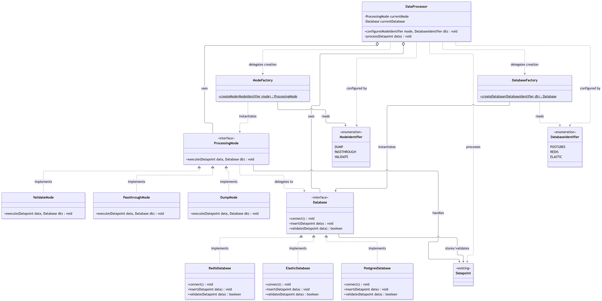

# Dynamically Reconfigurable Data Processor Architecture


A modular UML class architecture for a data processing pipeline that can switch between ingestion modes and database targets at runtime. It was designed for Task 2 of the Walmart USA Advanced Software Engineering Job Simulation.

## Table of Contents

- [Architectural Overview](#architectural-overview)
- [Design Patterns and SOLID Principles](#design-patterns-and-solid-principles)
- [Components at a Glance](#components-at-a-glance)
- [Project Structure](#project-structure)

## Architectural Overview


Hardcoding `if/else` logic for every combination of processing mode and database target makes a pipeline rigid and hard to maintain, because each new option multiplies the branches that must be updated.

This design avoids that by separating **processing behavior** from **storage persistence**. The **Strategy Pattern** makes each of them swappable, and the **Factory Pattern** keeps object creation out of the main router. The structure follows **SOLID** design principles throughout.

## Design Patterns and SOLID Principles

- **Strategy Pattern (`ProcessingMode` and `Database`):** Ingestion modes (`DumpMode`, `PassthroughMode`, `ValidateMode`) and storage engines (`PostgresDatabase`, `RedisDatabase`, `ElasticDatabase`) sit behind clean interfaces. `DataProcessor` can swap either one at runtime through `configure()`.
- **Factory Pattern (`ModeFactory` and `DatabaseFactory`):** Instantiation logic is kept out of `DataProcessor`, so the main router only orchestrates data flow. This supports the **Single Responsibility Principle**.
- **Open/Closed Principle:** New processing modes (such as transformation or dead-letter routing) or new databases (such as Snowflake or MongoDB) can be added as new classes without changing existing processor logic.
- **Dependency Inversion Principle:** High-level orchestration depends on the `ProcessingMode` and `Database` abstractions, not on concrete database drivers.

## Components at a Glance

| Component | Role | Implementations |
| :--- | :--- | :--- |
| `DataProcessor` | Orchestrates the pipeline and reconfigures it at runtime via `configure()` | Not applicable |
| `ProcessingMode` | Strategy interface for ingestion behavior | `DumpMode`, `PassthroughMode`, `ValidateMode` |
| `Database` | Strategy interface for storage targets | `PostgresDatabase`, `RedisDatabase`, `ElasticDatabase` |
| `ModeFactory` | Creates the selected processing mode | Not applicable |
| `DatabaseFactory` | Creates the selected database target | Not applicable |

## Project Structure

```text
task-2-data-processor-architecture/
├── data_processor_architecture.pdf   # Exported UML class diagram
├── diagram.mmd                       # Mermaid.js source code
└── README.md                         # Architectural documentation
```
